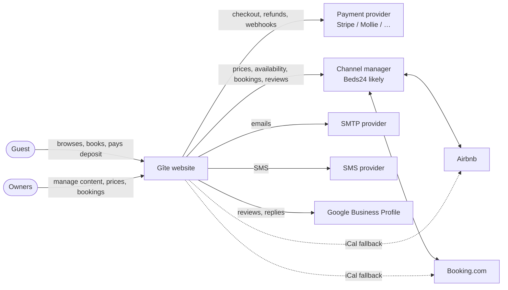
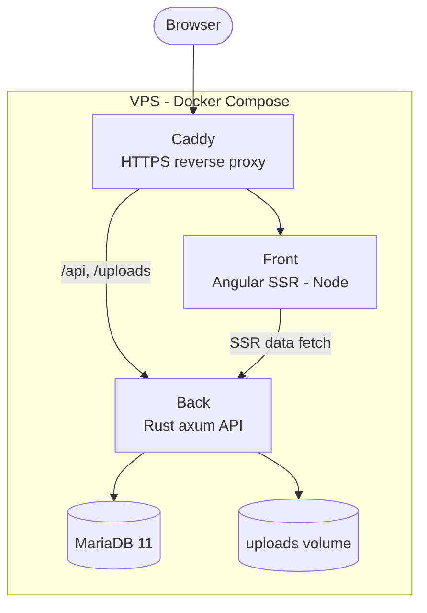
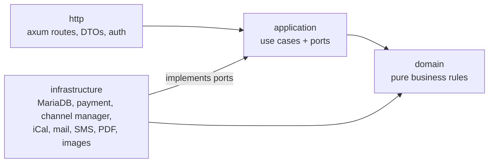

# Architecture overview (arc42, lite)

## 1. Introduction and goals

Website of a 3-star holiday cottage (gîte) in France:

* public showcase in French and English, mobile first;
* **instant direct booking** confirmed by an online deposit (see [ADR-0005](../adr/0005-instant-booking-with-online-deposit.md));
* mobile admin for the non-technical owners: pages, photos, prices per channel, calendar, bookings, payments, reviews, messages;
* synchronisation with Airbnb and Booking.com through a channel manager, iCal as fallback.

Quality goals, in priority order:

1. **Correctness** of money, dates and availability (no double booking, no wrong amount).
2. **Owner autonomy**: every business value is editable ([ADR-0010](../adr/0010-no-business-value-hardcoded.md)).
3. **Mobile usability** for guests and owners.
4. **Replaceability** of external services (payment, channel manager, SMS, mail).

## 2. Constraints

* Airbnb / Booking.com APIs are reserved to certified partners → channel manager or iCal.
* No card data on our server (PCI DSS SAQ A).
* Small budget: one small VPS, free/open-source dependencies with permissive licenses only.
* Public repository: no secrets, no personal data, no real guest data.

## 3. Context (C4 level 1)

## 4. Containers (C4 level 2)

## 5. Back-end building blocks (C4 level 3)

| Module | Responsibility |
|---|---|
| `domain/accommodation` | accommodation, rate periods, prices per channel |
| `domain/availability` | blocked periods (closure, family, private event), merging, conflicts |
| `domain/booking` | booking lifecycle, quote, payment schedule, cancellation, tourist tax |
| `domain/payment` | online and offline payments, deadlines, refunds |
| `domain/page` | pages, blocks, block validation |
| `domain/listing` | listing content per platform |
| `domain/stats` | occupancy, revenue, average price, cancellations, reviews |
| `domain/review` | reviews, criteria, moderation, owner replies |
| `domain/message` | message templates, schedule |

Rule: `domain` depends on nothing external; `http` contains no business logic and no SQL.

## 6. Deployment

Docker Compose on one VPS: Caddy (Let's Encrypt), Front (Node SSR), Back (Rust binary), MariaDB (not exposed), daily `mariadb-dump` + uploads backup off-site with rotation.

The Angular SSR server only answers requests whose `Host` header is allowed (SSRF protection): `localhost` and `127.0.0.1` in `Front/angular.json`; the production domain must be added there (or in `NG_ALLOWED_HOSTS`) when it is bought.

## 7. Cross-cutting concepts

* **Money** in integer cents (`Money`), never floats; VAT breakdown computed from gross amounts.
* **Time**: stay dates as `DATE`; timestamps stored in UTC, displayed in Europe/Paris; scheduled jobs use Paris time.
* **Settings**: business values in the database with seeded defaults, copied onto bookings when made.
* **Configuration**: technical choices in `config/*.toml` (one active payment provider, one active channel manager), secrets in `.env` only; validated at startup (fail fast).
* **Privacy**: the public API never reveals why a date is unavailable nor its origin (dedicated DTO).
* **Errors**: typed errors (`thiserror`), mapped to HTTP in one place.
* **i18n**: FR/EN content columns, French fallback.

## 8. Risks and technical debt

| Risk | Mitigation |
|---|---|
| Double booking during iCal delay | hold + re-check before payment; channel manager; conflict alert + full refund |
| Platform disconnected from the channel manager | connection monitor, greyed-out features, queued resend |
| Provider pricing or terms change | providers behind ports, selected by config |

## 9. Decisions

See [docs/adr](../adr/).
